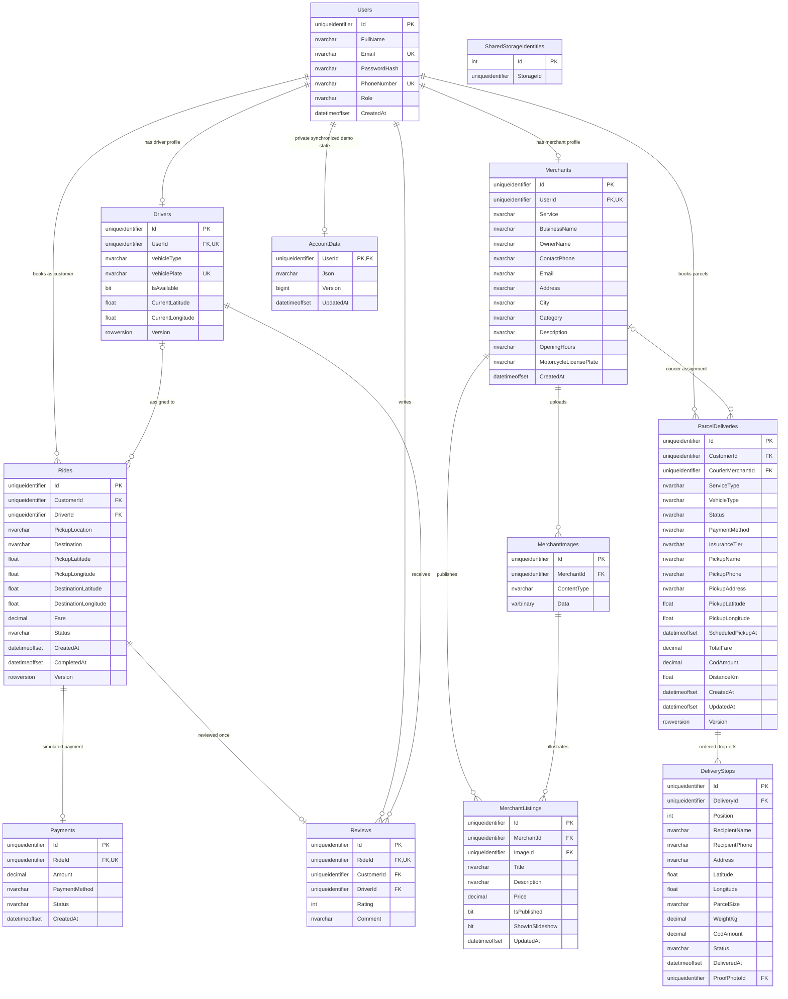

# SQL Server schema

DriverId and CompletedAt in Rides, driver coordinates, and review Comment are nullable. Foreign keys use restricted deletes. Payment/review uniqueness is enforced in SQL as well as the service. Rating has a SQL CHECK constraint. Customer/date and driver/status compound indexes support history and assigned ride queries. Money is decimal(12,2), development fare currency USD.

PhoneNumber is normalized and unique and is the sign-in identifier. Email is nullable, retained for legacy records, and has a filtered unique index for non-null values. New phone-only accounts have no email; their password remains hashed.

Merchant profile email is an optional public business contact, separate from the legacy Users.Email column. Merchant services are stored as GrabRide, GrabFood or GrabExpress. The public DTO omits OwnerName and UserId. Merchant listings have a positive-price CHECK constraint and decimal(12,2) USD prices. Service checks ensure the attached image belongs to the listing's merchant. Only published listings enter public feeds and storefronts; only published featured listings enter homepage banners. The MerchantPublishing migration adds these three tables.

The RideMerchantDetails migration adds nullable MotorcycleLicensePlate (maximum 30 characters). GrabRide registration/profile saves require this value, and public DTOs omit it. GrabRide uses OwnerName as its public BusinessName and Address as the rider's location; other business fields need not be supplied.

SharedAccountData stores each user's existing demo cart/orders, Express deliveries, wallet, addresses, favourites, reviews and settings as a private JSON snapshot. Version is an EF concurrency token, so concurrent/stale writes return 409 instead of silently replacing data. Snapshots save atomically and cannot target another JWT subject. SharedStorageIdentity creates one public, randomly generated StorageId per initialized database; client PCs can compare it to catch separate database setups. Existing tables and application records are preserved by both additive migrations.

The additive `ParcelDeliveries` migration adds server-authoritative parcel bookings and ordered `DeliveryStops`. Prices, contact snapshots, COD/insurance choices, courier GPS, timestamps and proof-photo references are stored separately from legacy Express demo snapshots. Delivery rowversion prevents double claims; a filtered unique index permits one active delivery per courier merchant. Stop position is unique within each delivery, and SQL checks protect fare totals, weights and COD bounds.
