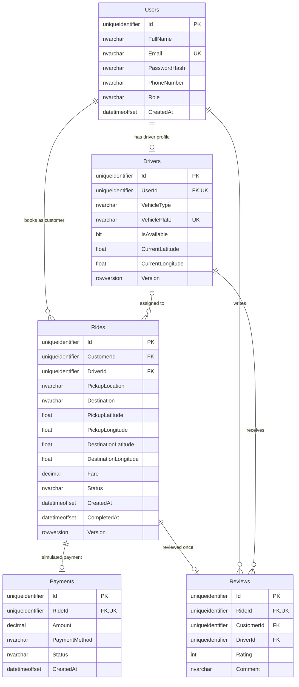

# SQL Server schema

DriverId and CompletedAt in Rides, driver coordinates, and review Comment are nullable. Foreign keys use restricted deletes. Payment/review uniqueness is enforced in SQL as well as the service. Rating has a SQL CHECK constraint. Customer/date and driver/status compound indexes support history and assigned ride queries. Money is decimal(12,2), development fare currency USD.
