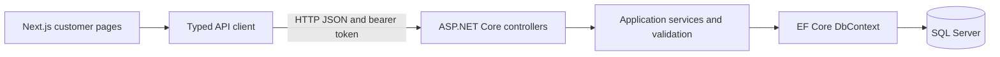

# Connect GrabRide, GrabFood and GrabExpress

Prepared after the [frontend audit](../frontend/AUDIT.md), 16 November 2026. This is a plan for the next implementation phase; endpoints marked proposed do not exist yet.

Update: merchant publishing, homepage banners and SQL-backed account snapshot synchronization have since been implemented. Signed-in Food/Express/account demo state persists through `GET/PATCH /api/account-data`, with public store reviews and a shared-storage diagnostic endpoint. Express Phase 1 now has additive `ParcelDeliveries`/`DeliveryStops` tables and a server-priced delivery API. The current Express customer pages still use the demo store; frontend integration, road pricing, merchant courier UI and tracking remain in Phases 2–4. See [shared setup](../SHARED_SETUP.md).

## Keep the existing stack

The repository already has ASP.NET Core 10 controllers, EF Core 10 with SQL Server, JWT authentication, role checks, Swagger, migrations and SQL-backed integration tests. The Next.js frontend already calls the auth/ride endpoints through `frontend/lib/api.ts` and a per-browser `AuthProvider`. Extend this implementation rather than creating a second backend.

SQL Server connection configuration belongs in backend User Secrets/environment settings. The frontend only receives `NEXT_PUBLIC_API_URL`. Configure the exact frontend origin in the existing named CORS policy. The current `http://localhost:3000` → `http://localhost:5000` setup was checked successfully.

References: [Microsoft EF SQL Server provider](https://learn.microsoft.com/en-us/ef/core/providers/sql-server/), [ASP.NET Core CORS](https://learn.microsoft.com/en-us/aspnet/core/security/cors?view=aspnetcore-10.0).

## Implementation order

1. **Contract cleanup:** preserve existing auth/ride routes; add vehicle/fare quote support and `reviewed` state to ride responses. Keep demo/live behavior explicit. Add integration tests before changing their contracts.
2. **Express:** add quote, booking, history, details, courier transitions and cancellation. Replace `lib/express.ts` with a service adapter while retaining the page's loading/error/confirmation states.
3. **Food catalogue:** seed the six current restaurants, menus and item options into SQL. Keep existing slugs/codes in API DTOs so frontend links and cart item identifiers remain stable.
4. **Food checkout/history:** quote and create orders on the server, enforce store hours/options/quantity/promos, persist line-price snapshots, implement order transitions and review/reorder rules. Replace the browser cart's order-placement/history adapter.
5. **Account features:** addresses, favourites, store reviews, banners and a simulated wallet ledger. Keep wallet debit and order creation atomic. Decide whether to retain guest carts and require authentication at checkout.
6. **Browser verification:** run the actual customer flows against the API, then cover role/ownership failures and concurrency with isolated SQL-backed tests.

Do not reset the existing database or regenerate `InitialCreate`. Add new migrations for each model change, review them, and apply them through the established EF workflow.

## Endpoint map

| Module | Existing endpoints | Proposed additions |
|---|---|---|
| Auth | `POST /api/auth/register`, `POST /api/auth/login`, `GET/PATCH /api/auth/me` (own profile name) | Decide session refresh/logout requirements |
| Ride | `/api/rides`, `/api/rides/mine`, `/api/rides/{id}`, `/api/rides/{id}/status` | Fare quotes, supported vehicle type, durable reviewed/payment state |
| Express | Phase 1: quote, create, mine, details, cancel, courier inbox/claim/status/stop/COD/location endpoints | Frontend adapter and customer/courier interfaces in Phases 2–4 |
| Food catalogue | None | `GET /api/stores`, `GET /api/stores/{slug}`, `GET /api/stores/{slug}/items` |
| Food orders | None | `POST /api/orders/quote`, `POST /api/orders`, `GET /api/orders/mine`, `GET /api/orders/{id}`, `PATCH /api/orders/{id}/status` |
| Food reviews | None | `GET /api/stores/{slug}/reviews`, `POST /api/orders/{id}/review` |
| Addresses | None | `GET/POST /api/addresses`, `PUT/DELETE /api/addresses/{id}` |
| Favourites | None | `GET /api/favorites`, `PUT/DELETE /api/favorites/{storeId}` |
| Wallet | None | `GET /api/wallet`, `GET /api/wallet/transactions`, `POST /api/wallet/topups` (simulated) |
| Home banners | None | `GET /api/banners` matching the existing frontend `Banner` type |

Extend the CORS method allow-list when adding PUT/DELETE. Apply authorization and ownership checks to every private endpoint. A customer can cancel a pending/assigned parcel; only its assigned courier can mark it collected/delivered. Use rowversion/concurrency checks as the existing ride service does.

## EF model additions

| Entities | Required relationships/data |
|---|---|
| `ParcelDelivery`, `DeliveryStop` (Phase 1 complete) | Customer, optional courier, contact/address snapshots, ordered drop-offs, coordinates, size, decimal weight, fare breakdown, COD, insurance, status, timestamps and rowversion. Quotes are recalculated rather than stored. |
| `Store`, `MenuItem`, `OptionGroup`, `OptionChoice` | Stable slug/code, bilingual labels, decimal prices, store timezone/hours, availability, option requirements |
| `FoodOrder`, `FoodOrderLine`, line option snapshots | Customer/store, address and note snapshot, item quantities/options, price breakdown, status/timestamps, rowversion |
| `Promotion`, promotion usage | Eligibility, minimum spend, discount cap, usage limits; first-order eligibility comes from SQL history |
| `SavedAddress`, `Favorite`, `StoreReview`, `Banner` | User ownership; unique favourite and one review per completed order; ordered enabled banners |
| `Wallet`, `WalletTransaction` | User, decimal balance/amount, transaction kind, linked order/delivery, unique payment reference, concurrency protection |

Use `decimal` with explicit precision for currency/weight; UTC timestamps and string enums in JSON. Add foreign keys, unique constraints and status validation. Preserve historical order line prices even when the menu changes.

## Express contract boundary

The demo form stores landmark indexes (`pickupPlace`, `dropoffPlace`). These indexes are frontend implementation details: translate them into named locations and latitude/longitude before sending a real API request. Sender/recipient each need a name, phone and full street address. The backend validates parcel size/weight and computes the charge; it never trusts a client-supplied fare or status.

A Phase 1 quote response includes a distance/fare breakdown and five-minute display expiry; booking recalculates the price instead of trusting or referencing a quote ID. A unique booking request key remains future work. The API exposes server status/timestamps, while the current customer history still uses a demo timer until its adapter is replaced. Road-route pricing, courier proof, and recipient tracking are separate phases.

Food uses the same pattern: submit store/item IDs, quantities, valid option IDs, address, payment method, promo and tip; receive server-calculated totals. Store and wallet updates must complete within a transaction. Payment APIs remain simulated until a payment provider is explicitly integrated.

## Acceptance checks

- Refreshing or changing device retrieves the signed-in user's SQL-backed history.
- Users cannot read/cancel/pay/review another user's order or parcel.
- Invalid addresses/weights/options, closed stores and unsupported status transitions produce field-level ProblemDetails.
- Expired quotes, double submissions, simultaneous wallet payments and concurrent courier acceptance are handled without duplicate charges or assignments.
- Empty/loading/error/retry states remain usable when the API is down; demo results are visibly labelled and kept separate from API data.
- Full browser tests cover Ride, Food and Express on phone and desktop in English/Khmer.
